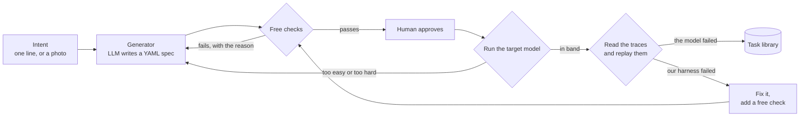

# 2. Pipeline design

The pipeline turns a one-line intent into a checked MuJoCo task. An LLM writes the task. Code decides whether it is any good.

## Generator

`python rua/generate.py "test whether the agent can ..."`

- The model writes a YAML spec and nothing else: the objects, where they can start, what counts as success, a scripted solution, and the difficulty knobs. Fixed code builds the scene from it.
- If a check fails, the exact failure goes back to the model. It gets up to five rounds.
- A photo of a real table also works as input. `rua/intent.py` maps what it sees onto our building blocks and proposes tasks aimed at known weak spots.

**Why a spec and not code.** Generated task code usually runs but is often wrong, and placement bugs are the common case (AnyTask, GenSim). A spec can be validated field by field before any physics runs.

**What it can build.** Boxes, cylinders, spheres, a hook, a drawer, a block with a hole, a ledge, a seesaw, a box with a sliding lid, painted zones, and scanned household objects from a small catalog. Also hidden weights, slippery surfaces, seeds where the task is impossible, and goal images.

## Discriminator

Cheapest checks run first. Anything that fails goes back with its reason.

| Check | What it catches | Cost |
|---|---|---|
| Schema and prompt lint | Missing fields; a prompt that doesn't state the success threshold | Free |
| Settle, joints, reach, visible | Objects that fall over at the start, a jammed drawer, things the hand can't get to or the camera can't see | Free |
| Trivial | Tasks that pass if the robot does nothing, or moves at random | Free |
| Oracle | The scripted solution has to work, in the sim and through the real tool | Free |
| Robust | The solution still works with every placement 5 mm off | Free |
| Truth test (15 checks) | Whether everything we tell the agent is true: axes, camera layout, grasp feedback | Free |
| Asset admission | A scanned object that can't be gripped, won't release, or doesn't rest flat | Free |
| Model run | Whether the task lands in the target band | Paid |
| Trace review and replay | Whether a failure is the model's or ours | Free |

Each model run also reports three counts: failures that hit the step cap, failures where the arm jammed, and failures that stopped just short of the step budget. A low score is not read as "hard" until the first two are zero and the third has been read.

## Harness

- HUD's DirectControl with `move_to` (end-effector pose and gripper). The SDK serves one motion tool per environment. `move_joints` would be a launch setting. I scoped it and did not build it, because it changes the problem from "do the task" to "do inverse kinematics".
- Two cameras, top and wrist. After each move the agent is told whether the fingers met, and whether the move stopped short of its target.
- Grading is on the final state, one condition at a time, so a zero says which part failed.

## The five tasks

| Task | Spec | Generator | Astra | Rollouts |
|---|---|---|---|---|
| max_overhang | `tasks/max_overhang.yaml` | Regenerated from one line | 5/18 | [1](https://www.hud.ai/jobs/193ec7c258ab4d6a8730d7ab79144f26), [2](https://www.hud.ai/jobs/1652b36b603e4e66b43121918fe6aaa8), [3](https://www.hud.ai/jobs/423adafa92cc48febbc22d8a1cfe5c68) |
| balance_sort | `tasks/balance_sort.yaml` | Regenerated from one line | 1/12 | [1](https://www.hud.ai/jobs/6ca5c2608aea48dfb85781c7ff4dd899), [2](https://www.hud.ai/jobs/71b00f9d00244b08a137b0d87bfe33a3), [3](https://www.hud.ai/jobs/7aea5806aff543a585425c93a918b480) |
| weighted_overhang | `tasks/weighted_overhang.yaml` | Not yet | 0/12 | [1](https://www.hud.ai/jobs/3a19fb37768e49afb70514660a3acb7f), [2](https://www.hud.ai/jobs/2f29cee8ff454abf849e33412d0b3654), [3](https://www.hud.ai/jobs/d941c18f07d340e395c9fe23de0e6ec7), [4](https://www.hud.ai/jobs/522e6996f902453ab6b7db4ca8f7e653) |
| balance_pick | `tasks/balance_pick.yaml` | Regenerated from one line | 1/5 | [1](https://www.hud.ai/jobs/8b16fde453ee4fc2a8627a981134b14a) |
| overhang_or_impossible | `tasks/overhang_or_impossible.yaml` | Not yet | 3/5 | [1](https://www.hud.ai/jobs/fec577767283441394044b47c5531d9c) |

All five pass every free check, and the scripted solution works 5/5 through the real tool.

I wrote all five specs by hand first, and the rollouts above ran on those. I then gave the generator a one-line intent for each. It rebuilt three of them, and its versions pass the same checks (`tasks/generated/`, waiting for approval). For the other two it had not produced a passing version when I stopped.

To run one: `TASK=max_overhang HUD_LLM_MODEL=gpt-6-astra STEPS=60 EPISODES=5 python rua/run.py`

## Choices and what I turned down

| Choice | Why | Turned down |
|---|---|---|
| The LLM writes YAML, code builds the scene | Checkable before any physics runs | LLM-written scene code |
| A closed set of building blocks | Each one is tested once; the generator can't invent broken assets | Open asset generation |
| A scripted solution for every task | Proves the task can be done before a model is paid to try | Trusting a model's success as the proof |
| Final-state grading | Can't be gamed by passing through the goal | Rewards along the way |
| A human approves each generated task | One glance at a render catches what the checks can't | Fully automatic acceptance |

The full log of decisions, with reasons, is in `docs/decisions.md`.
