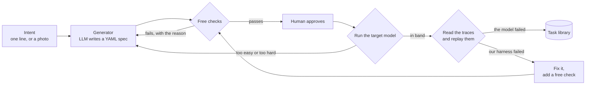

# 2. Pipeline design

The pipeline turns a one-line intent into a checked MuJoCo task. An LLM writes the task. Code decides whether it is any good.

## Generator

`python rua/generate.py "test whether the agent can ..."`

The model writes a YAML spec and nothing else: the objects, where they can start, what counts as success, a scripted solution, and the difficulty knobs. Fixed code builds the scene from it.

**Why a spec and not code.** Every earlier system I read has the LLM write task code, and they report the same weak point. In AnyTask the most common error is in `reset()`, where objects get placed. GenSim lists made-up assets as its first implementation error. RoboGen lost 13 of 155 tasks to broken scenes. Those are all things code can do deterministically, so I took them away from the model. It chooses what goes in the scene; code decides where things land.

**Why a closed set of building blocks.** GenSim2 found that composing tasks from parts already known to work beats asking the LLM to break a task down from the top (0.68 against 0.54 solution rate). Each of our blocks is tested once and reused. The model cannot invent an asset.

**Why failures go back with the exact reason, for up to five rounds.** RoboTwin 2.0 runs the same loop and needs 1.76 rounds on average. Ours took 1 to 5.

**Why a photo is an optional input.** The brief asks for it. `rua/intent.py` maps what it sees onto our building blocks and refuses anything that doesn't fit, so a photo can't smuggle in an object we have never tested.

**What it can build.** Boxes, cylinders, spheres, a hook, a drawer, a block with a hole, a ledge, a seesaw, a box with a sliding lid, painted zones, and scanned household objects from a small catalog. Also hidden weights, slippery surfaces, seeds where the task is impossible, and goal images.

## Discriminator

The usual funnel in this literature is: the code compiles, it runs, the generator's own solver finishes the task, a person or a vision model looks at it. That proves a task can be solved. It does not prove the grader is right. I found no generator paper that checks whether a robot doing nothing can pass.

Benchmarks outside robotics show why that matters. In τ-bench a trivial agent passes 38% of tasks (Agentic Benchmark Checklist). OpenAI audited the SWE-bench Verified problems that o3 kept failing and found 59% had flawed tests. So most of my checks are aimed at the grader and the harness, not the scene.

Cheapest checks run first. Anything that fails goes back with its reason.

| Check | What it catches | Why it's there |
|---|---|---|
| Schema and prompt lint | Missing fields; a prompt that doesn't state the success threshold | An agent can't hit a threshold it was never told |
| Settle, joints, reach, visible | Objects that fall at the start, a jammed drawer, things the hand can't reach or the camera can't see | Each one caught a real bug in our own scenes |
| Trivial | Tasks that pass if the robot does nothing or moves at random | The missing negative control described above |
| Oracle | The scripted solution works, in the sim and through the real tool | Standard practice (GenSim, GenSim2), with the addition that it must go through the same tool the agent uses |
| Robust | The solution still works with every placement 5 mm off | Our tool only stops within about 1 cm. A peg task at 7 mm clearance passed the oracle, and sol's 0/10 on it measured our tool, not sol |
| Truth test (15 checks) | Whether everything we tell the agent is true | All eight of luna's first failures were things we had told it wrong |
| Asset admission | A scanned object that can't be gripped, won't release, or doesn't rest flat | Same idea as the truth test, for objects |
| Model run | Whether the task lands in the band | Only a model can measure difficulty |
| Trace review and replay | Whether a failure is the model's or ours | See doc 3. Half our hard results failed this |

Two choices inside that table:

- **Code does the judging, and a person takes one look.** I did not use a vision model as the judge. RoboTwin 2.0's reached an F1 of only 0.30 and called misaligned stacks successes. GenSim gets by with about ten seconds of human review per task, so I kept a human approval step with a one-page review sheet.
- **Success requires the object released and at rest.** ManiSkill requires the robot to be still for the same reason: it stops an agent from scoring by passing through the goal.

Each model run also reports three counts: failures that hit the step cap, failures where the arm jammed, and failures that stopped just short of the step budget. A low score is not read as "hard" until the first two are zero and the third has been read.

**On the 5-30% band.** I kept the band from the brief. The papers I found on difficulty filtering argue for about 50%, because a pass/fail signal carries the most information there (Online Difficulty Filtering, DAPO). I could not find a source for 5-30% and have listed it as an open question in doc 3. For sample size, simple binomial arithmetic says 10 episodes cannot tell 5% from 30%, so the sol calibrations used 20 or more.

## Harness

What the agent sees and does matters as much as the model. JustRUA raised one benchmark from 29.7 to 50.3 by changing only the harness. So each harness choice follows a measured result where I could find one.

| Choice | Why |
|---|---|
| `move_to` with absolute end-effector poses | Relative moves cost 14 points on precision tasks in JustRUA. `move_joints` would make the model do the arm's geometry in its head, with no evidence that LLMs can. The SDK serves one motion tool per environment, so it would be a launch setting. I scoped it and did not build it |
| Images after every move | Showing images only on request dropped success from 83% to 68.5% (PyRUA-Lean) |
| Two cameras, top and wrist | More cameras are not reliably better: a third view changed scores by -3.6, +5.8 and +10.7 across three models (Anthropic). In our runs one angled camera left luna unable to judge depth, and the wrist view fixed it |
| A plain-words grasp line ("fingers met; nothing between them") | On real arms 32-64% of grasps close on nothing (Bitter Lesson), and compact readings beat verbose JSON (JustRUA) |
| A line saying when a move stopped short | In the LIBERO-10 study arms reached only 64-72% of the commanded distance, and models could not work out why |
| Full history, medium effort | Keeping every image beat keeping the last two (JustRUA). Astra peaked at medium effort there, and high effort changed nothing in our one test |
| Grading on the final state, hidden from the agent | Models claim success on 24-39% of unfinished subtasks (RoboARCade), so the agent's word cannot be the grade |
| MuJoCo with the Menagerie Panda and mink IK, moves interpolated | A local benchmark showed that commanding a pose as one jump dropped a held cube, and interpolating kept it |

## The five tasks

| Task | Spec | Generator | Astra | Rollouts |
|---|---|---|---|---|
| max_overhang | `tasks/max_overhang.yaml` | Regenerated from one line | 5/18 | [1](https://www.hud.ai/jobs/193ec7c258ab4d6a8730d7ab79144f26), [2](https://www.hud.ai/jobs/1652b36b603e4e66b43121918fe6aaa8), [3](https://www.hud.ai/jobs/423adafa92cc48febbc22d8a1cfe5c68) |
| balance_sort | `tasks/balance_sort.yaml` | Regenerated from one line | 1/12 | [1](https://www.hud.ai/jobs/6ca5c2608aea48dfb85781c7ff4dd899), [2](https://www.hud.ai/jobs/71b00f9d00244b08a137b0d87bfe33a3), [3](https://www.hud.ai/jobs/7aea5806aff543a585425c93a918b480) |
| weighted_overhang | `tasks/weighted_overhang.yaml` | Failed after 5 rounds | 0/12 | [1](https://www.hud.ai/jobs/3a19fb37768e49afb70514660a3acb7f), [2](https://www.hud.ai/jobs/2f29cee8ff454abf849e33412d0b3654), [3](https://www.hud.ai/jobs/d941c18f07d340e395c9fe23de0e6ec7), [4](https://www.hud.ai/jobs/522e6996f902453ab6b7db4ca8f7e653) |
| balance_pick | `tasks/balance_pick.yaml` | Regenerated from one line | 1/5 | [1](https://www.hud.ai/jobs/8b16fde453ee4fc2a8627a981134b14a) |
| overhang_or_impossible | `tasks/overhang_or_impossible.yaml` | Regenerated from one line | 3/5 | [1](https://www.hud.ai/jobs/fec577767283441394044b47c5531d9c) |

All five pass every free check, and the scripted solution works 5/5 through the real tool.

I wrote all five specs by hand first, and the rollouts above ran on those. I then gave the generator a one-line intent for each. It rebuilt four of them, and its versions pass the same checks (`tasks/generated/`, waiting for approval). It failed on weighted_overhang after five rounds: it could not find a stack of off-centre blocks that still stands when every placement is 5 mm off. That is the hardest scripted solution of the five, and it took me several tries by hand too.

To run one: `TASK=max_overhang HUD_LLM_MODEL=gpt-6-astra STEPS=60 EPISODES=5 python rua/run.py`

## What I turned down

| Instead of | I chose | Because |
|---|---|---|
| LLM-written scene code | A YAML spec built by fixed code | Placement and asset errors dominate generated code (AnyTask, GenSim, RoboGen) |
| Open asset generation | A closed, tested set | Bottom-up composition from known parts works better (GenSim2) |
| A vision model as judge | Coded checks plus one human look | VLM judges are unreliable (RoboTwin 2.0) |
| Trusting a model's success as proof a task works | A scripted solution through the real tool | A model's failure can't tell you whether the task or the model is broken |
| Rewards along the way | Final-state grading | It can't be gamed by passing through the goal |

The full log of decisions is in `docs/decisions.md`.

## Sources

- GenSim, [arXiv 2310.01361](https://arxiv.org/html/2310.01361v2). GenSim2, [arXiv 2410.03645](https://arxiv.org/html/2410.03645)
- RoboGen, [arXiv 2311.01455](https://arxiv.org/html/2311.01455v3). AnyTask, [arXiv 2512.17853](https://arxiv.org/html/2512.17853v2)
- RoboTwin 2.0, [arXiv 2506.18088](https://arxiv.org/html/2506.18088v2)
- Agentic Benchmark Checklist, [arXiv 2507.02825](https://arxiv.org/html/2507.02825v5). OpenAI on [SWE-bench Verified](https://openai.com/index/why-we-no-longer-evaluate-swe-bench-verified/)
- Online Difficulty Filtering, [arXiv 2504.03380](https://arxiv.org/html/2504.03380v2). DAPO, [arXiv 2503.14476](https://arxiv.org/pdf/2503.14476v2)
- ManiSkill2, [arXiv 2302.04659](https://arxiv.org/pdf/2302.04659)
- JustRUA, [arXiv 2611.16009](https://arxiv.org/abs/2611.16009). PyRUA-Lean, [arXiv 2610.01939](https://arxiv.org/pdf/2610.01939)
- Anthropic, [Claude plays robotics](https://www.anthropic.com/research/claude-plays-robotics)
- The Bitter Lesson Comes to Robotics, [arXiv 2610.25287](https://arxiv.org/html/2610.25287v1). LIBERO-10 frontier evaluation, [arXiv 2610.30051](https://arxiv.org/abs/2610.30051). RoboARCade, [arXiv 2611.08209](https://arxiv.org/abs/2611.08209)
- Longer notes: `reports/Synthetic robot task generation review.md` and `reports/RUA harness failure factors.md`
