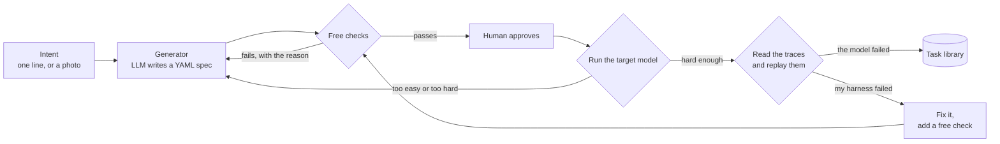

# Pipeline design

The pipeline takes one sentence describing a task, such as "test whether the agent can stack blocks out past a ledge", and turns it into a working simulation task. A language model writes the task. Code I wrote decides whether it is any good, before any model is paid to attempt it.

## Generator

You run it with `python rua/generate.py "test whether the agent can ..."`.

The model does not write simulation code. It fills in a short task description in YAML: which objects are on the table, where each one can start, what counts as success, a scripted solution, and the settings that make the task easier or harder. Code I wrote once turns that description into the actual scene.

**Why a description and not code.** Every earlier system I read has the model write the task's code, and they all report the same weak point. In AnyTask the most common error is in the part that places objects on the table. GenSim's most common error is the model using objects that don't exist. RoboGen lost 13 of 155 tasks to broken scenes. Code can do all of that reliably, so I took it away from the model. The model decides what goes in the scene. Code decides where things land.

**Why a fixed list of objects.** GenSim2 found that building tasks from parts already known to work succeeds more often than having the model design everything from the top (0.68 against 0.54). Each of my objects was tested once and is reused. The model can't invent a new one.

**Why it gets its mistakes back.** When a check fails, the model is told exactly which check and why, and tries again, up to five times. RoboTwin 2.0 uses the same loop and needs 1.76 tries on average. Mine needed between 1 and 5.

**Why a photo also works as input.** The brief asks for it. `rua/intent.py` looks at a photo of a real table, matches what it sees to my list of objects, and refuses anything that isn't on the list, so a photo can't bring in an object that hasn't been tested.

**What it can build.** Boxes, cylinders, balls, a hook, a drawer, a block with a hole in it, a ledge, a seesaw, a box with a sliding lid, circles painted on the table, and scanned household objects from a small catalogue. Also hidden weights, slippery surfaces, attempts where the task is deliberately impossible, and goal photos to match.

## Checks

The usual process in this literature is: the code runs, the generator's own solver finishes the task, and a person or a vision model looks at the result. That proves the task can be done. It does not prove the grading is right. I found no generator paper that checks whether a robot that does nothing at all could pass.

Benchmarks outside robotics show why that matters. In one well-known agent benchmark (τ-bench), an agent that does nothing useful still passes 38% of tasks. When OpenAI looked at the SWE-bench Verified problems its model kept failing, 59% turned out to have broken tests. So most of my checks target the grading and the setup around the model, not the scene.

The cheap checks run first. Anything that fails goes back to the generator with the reason.

| Check | What it catches | Why I added it |
|---|---|---|
| Format and prompt | Missing fields, or instructions that never state the success threshold | An agent can't hit a threshold it was never told |
| Scene sanity | Objects that fall over at the start, a stuck drawer, things the arm can't reach or the camera can't see | Each of these caught a real bug in one of my scenes |
| Doing nothing | A task that passes if the robot does nothing, or moves at random | The check the literature leaves out |
| Scripted solution | The task can actually be done, using the same `move_to` tool the agent gets | Proves the task is possible before a model is paid to try it |
| Small errors | The scripted solution still works with every placement 5 mm off | The tool only places to within about a centimetre. A peg task with 7 mm of clearance passed every other check, and sol's 0 of 10 on it was measuring my tool, not sol |
| Truth test (15 checks) | Whether everything the agent is told is actually true, such as which way is left in the camera image | All eight of luna's first failures came from things I had told it wrong |
| Object admission | A scanned object that can't be gripped, won't let go, or doesn't sit flat | The same idea as the truth test, for objects |
| Model run | How hard the task is for the target model | Only a model can measure difficulty |
| Reading and replaying attempts | Whether a failure was the model's fault or mine | See doc 3. Half of my "hard" results failed this one |

Two choices behind that table:

- **Code does the judging, and a person takes one look.** I didn't use a vision model as the judge. In RoboTwin 2.0, most of the successes its judge reported were wrong, including badly misaligned stacks. GenSim gets by with about ten seconds of human review per task, so the pipeline produces a one-page picture of each task for a person to approve.
- **An object only counts once it has been let go and is at rest.** ManiSkill requires the robot to be still at the end for the same reason. It stops a robot scoring by sweeping an object through the goal.

Every model run also reports three counts: failures that ran out of moves, failures where the arm got stuck, and failures that stopped just before the move limit. I don't treat a low score as "hard" until the first two are zero and I've looked at the third.

**On how hard a task should be.** The brief asks for tasks an agent passes 5-30% of the time. As we discussed, I measured this on Astra and treated the range as a guide: lower is fine for this project as long as the failure is real. So a task at 0% stays if the recordings show an honest failure, and most of my effort went into proving the failures were real. Ten attempts can't tell 5% from 30% apart, so when I tuned tasks for sol I used 20 or more.

## What the agent sees and does

The setup around the model matters as much as the model. JustRUA raised one benchmark from 29.7 to 50.3 just by changing that setup. So wherever I could find a measured result, I followed it.

| Choice | Why |
|---|---|
| The agent moves the gripper to a position (`move_to`), not each joint | JustRUA found that moving relative to the current position does no better than moving to a position (33.9 against 38.0). Commanding each joint would make the model do the arm's geometry in its head, and nothing shows that language models can. HUD's SDK offers one way of moving per task, so joint control would be a setting at launch. I scoped it and didn't build it |
| A picture after every move | Giving pictures only when the agent asked dropped success from 83% to 68.5% (PyRUA-Lean) |
| Two cameras, one above and one on the wrist | More cameras don't reliably help: adding a third changed scores by -3.6, +5.8 and +10.7 points across three models (Anthropic). In my runs, one angled camera left luna unable to judge depth, and adding the wrist camera fixed it |
| A plain-words line after each grasp ("fingers met; nothing between them") | On real arms, models close the gripper on nothing 32-64% of the time (Bitter Lesson) |
| A line saying when a move stopped short | In the LIBERO-10 study, arms covered only 64-72% of the distance they were told to, and the models couldn't work out why |
| The full history of the attempt, at medium effort | Keeping the full history lifted JustRUA's score from 29.7 to 34.7, at medium effort. Higher effort made no difference in my one test |
| Grading on the final state, which the agent doesn't see | Models claim success on 24-39% of steps they haven't finished (RoboARCade), so the agent's word can't be the grade |
| MuJoCo with a standard Franka model, moves played out gradually | In a test of my own, jumping straight to a new position made the arm drop the cube it was holding, and moving gradually didn't |

## The tasks

| Task | Spec file | Did the generator rebuild it? | Astra succeeded | Rollouts |
|---|---|---|---|---|
| max_overhang | `tasks/max_overhang.yaml` | Yes, from one sentence | 5 of 18 | [1](https://www.hud.ai/jobs/193ec7c258ab4d6a8730d7ab79144f26), [2](https://www.hud.ai/jobs/1652b36b603e4e66b43121918fe6aaa8), [3](https://www.hud.ai/jobs/423adafa92cc48febbc22d8a1cfe5c68) |
| balance_sort | `tasks/balance_sort.yaml` | Yes, from one sentence | 1 of 12 | [1](https://www.hud.ai/jobs/6ca5c2608aea48dfb85781c7ff4dd899), [2](https://www.hud.ai/jobs/71b00f9d00244b08a137b0d87bfe33a3), [3](https://www.hud.ai/jobs/7aea5806aff543a585425c93a918b480) |
| weighted_overhang | `tasks/weighted_overhang.yaml` | No | 0 of 12 | [1](https://www.hud.ai/jobs/3a19fb37768e49afb70514660a3acb7f), [2](https://www.hud.ai/jobs/2f29cee8ff454abf849e33412d0b3654), [3](https://www.hud.ai/jobs/d941c18f07d340e395c9fe23de0e6ec7), [4](https://www.hud.ai/jobs/522e6996f902453ab6b7db4ca8f7e653) |
| balance_pick | `tasks/balance_pick.yaml` | Yes, from one sentence | 1 of 5 | [1](https://www.hud.ai/jobs/8b16fde453ee4fc2a8627a981134b14a) |
| overhang_or_impossible | `tasks/overhang_or_impossible.yaml` | Yes, from one sentence | 3 of 5 | [1](https://www.hud.ai/jobs/fec577767283441394044b47c5531d9c) |

All of them pass every check, and the scripted solution works 5 of 5 times through the real tool.

I wrote these specs by hand first, and the rollouts above ran on my versions. Then I gave the generator one sentence for each and let it write its own version from scratch. Its versions are in `tasks/generated/`. To see whether a generated task is as hard as mine, not just similar on paper, I ran Astra on them.

| Task | My version | Generated version | Rollouts |
|---|---|---|---|
| max_overhang | 5 of 18 | 2 of 5 | [job](https://www.hud.ai/jobs/ca298106a4f94f63b5dd32a207e521b8) |
| overhang_or_impossible | 3 of 5 | 4 of 5 | [job](https://www.hud.ai/jobs/26809c2e12d74ea2993f5df18e8b6997) |
| balance_sort | 1 of 12 | 0 of 5 | [job](https://www.hud.ai/jobs/96f6599ff40b4ce398c4982e7e2e3f99) |
| balance_pick | 1 of 5 | 4 of 5 | [job](https://www.hud.ai/jobs/394a6c07ec5b4cb58509f3ba4d0c7d13) |
| hidden_weight | not one of my five | 2 of 5, and 3 more lost to arm jams | [job](https://www.hud.ai/jobs/1b5de27bef1b458cbf247661b350de81) |

Three of the first four came out about as hard as mine. The generator also made its own choices: in one version of balance_sort it colour-coded the circles where I had used left-to-right order, and it added a height check to max_overhang that I hadn't thought of.

balance_pick came out much easier, and the reason is worth knowing. The generator built a gentler seesaw. Its pivot is half as high, so the plank tilts less, and its swing is slowed ten times more. My version was hard because cubes slide off a plank that tips sharply, and the gentler one mostly removed that. So a task's difficulty can sit in a few physical numbers the one-sentence description never mentions. That is what the model-run step is for: a version this easy would go back to the generator instead of into the library.

Getting the balance tasks right took one fix. The generator's first versions laid the plank pointing away from the robot. That made Astra turn its wrist a quarter turn about three times per attempt, which set off the arm jam described in doc 3 in 6 of 10 attempts. I added one line to the generator's instructions, to lay long objects across the table. Its next versions did, and the arm didn't jam once in 10 attempts.

That gives five tasks the generator made on its own, each with Astra rollouts: max_overhang, overhang_or_impossible, balance_sort, balance_pick and hidden_weight. hidden_weight is the weakest. Two blocks each hide a weight at one end and have to stick out past a ledge. The two attempts the arm jam didn't spoil were both successes, so it is probably not hard for Astra. I kept weighted_overhang as a sixth task because it is my hardest result, 0 of 12.

weighted_overhang is the one task the generator couldn't produce. Its scripted solution has to stack four off-centre blocks so the tower still stands with every placement 5 mm off, and the generator didn't find one in the tries I gave it. Writing scripted solutions for delicate physical tasks is the generator's weak point. Doc 3 comes back to it.

To run one yourself: `TASK=max_overhang HUD_LLM_MODEL=gpt-6-astra STEPS=60 EPISODES=5 python rua/run.py`

## What I turned down

| The other option | What I did | Why |
|---|---|---|
| Have the model write the simulation code for each task, as most earlier systems do | The model fills in a short description of the task (which objects, where they can start, what counts as success). Code I wrote once turns that description into the scene | When models write the scene code themselves, it usually runs but puts objects in the wrong place or uses objects that don't exist. AnyTask, GenSim and RoboGen all report this as their most common failure. A description can be checked line by line before anything is simulated |
| Let the model invent any object it wants | The model picks from a fixed list of objects that I have each tested | GenSim2 found that building tasks out of parts already known to work succeeds more often than letting the model design from scratch (0.68 against 0.54) |
| Use a vision model to look at the result and judge whether the task is good | Checks written in code, plus one look by a person before a task is accepted | Vision models are poor judges here. In RoboTwin 2.0 the judge called misaligned stacks a success |
| Treat "a model solved it" as proof that the task works | Every task comes with a scripted solution that must succeed through the same tool the model uses | If a model fails a task, that alone can't tell you whether the model or the task is at fault. A scripted solution settles that before any model runs |
| Give points for progress along the way | Grade only the final state of the table | A robot can pass through the goal position without ever finishing the task. Grading the end state can't be fooled that way |

The full log of decisions is in `docs/decisions.md`.

## References

- GenSim, [arXiv 2310.01361](https://arxiv.org/html/2310.01361v2). GenSim2, [arXiv 2410.03645](https://arxiv.org/html/2410.03645)
- RoboGen, [arXiv 2311.01455](https://arxiv.org/html/2311.01455v3). AnyTask, [arXiv 2512.17853](https://arxiv.org/html/2512.17853v2)
- RoboTwin 2.0, [arXiv 2506.18088](https://arxiv.org/html/2506.18088v2)
- Agentic Benchmark Checklist, [arXiv 2507.02825](https://arxiv.org/html/2507.02825v5). OpenAI on [SWE-bench Verified](https://openai.com/index/why-we-no-longer-evaluate-swe-bench-verified/)
- ManiSkill2, [arXiv 2302.04659](https://arxiv.org/pdf/2302.04659)
- JustRUA, [arXiv 2611.16009](https://arxiv.org/abs/2611.16009). PyRUA-Lean, [arXiv 2610.01939](https://arxiv.org/pdf/2610.01939)
- Anthropic, [Claude plays robotics](https://www.anthropic.com/research/claude-plays-robotics)
- The Bitter Lesson Comes to Robotics, [arXiv 2610.25287](https://arxiv.org/html/2610.25287v1). LIBERO-10 frontier evaluation, [arXiv 2610.30051](https://arxiv.org/abs/2610.30051). RoboARCade, [arXiv 2611.08209](https://arxiv.org/abs/2611.08209)
- Longer notes: `reports/Synthetic robot task generation review.md` and `reports/RUA harness failure factors.md`
