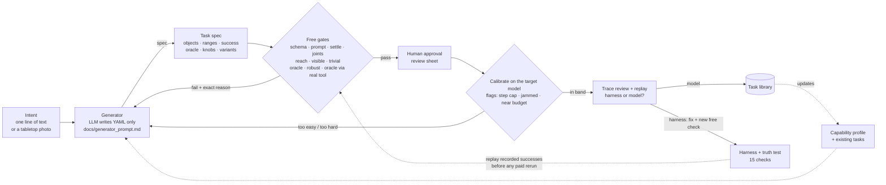

# Pipeline diagram (draft, for deliverable 2)

- Everything left of "Calibrate" is free and caught most problems (weak grip, jammed drawer, precision cliffs, grading crash).
- Calibration only measures difficulty. A low score is not read as capability until the flags are zero and a replay shows the failure is the model's.
- Every harness fault found becomes a free check, so the discriminator tightens over time; replay of recorded episodes is the regression test for the harness itself.
